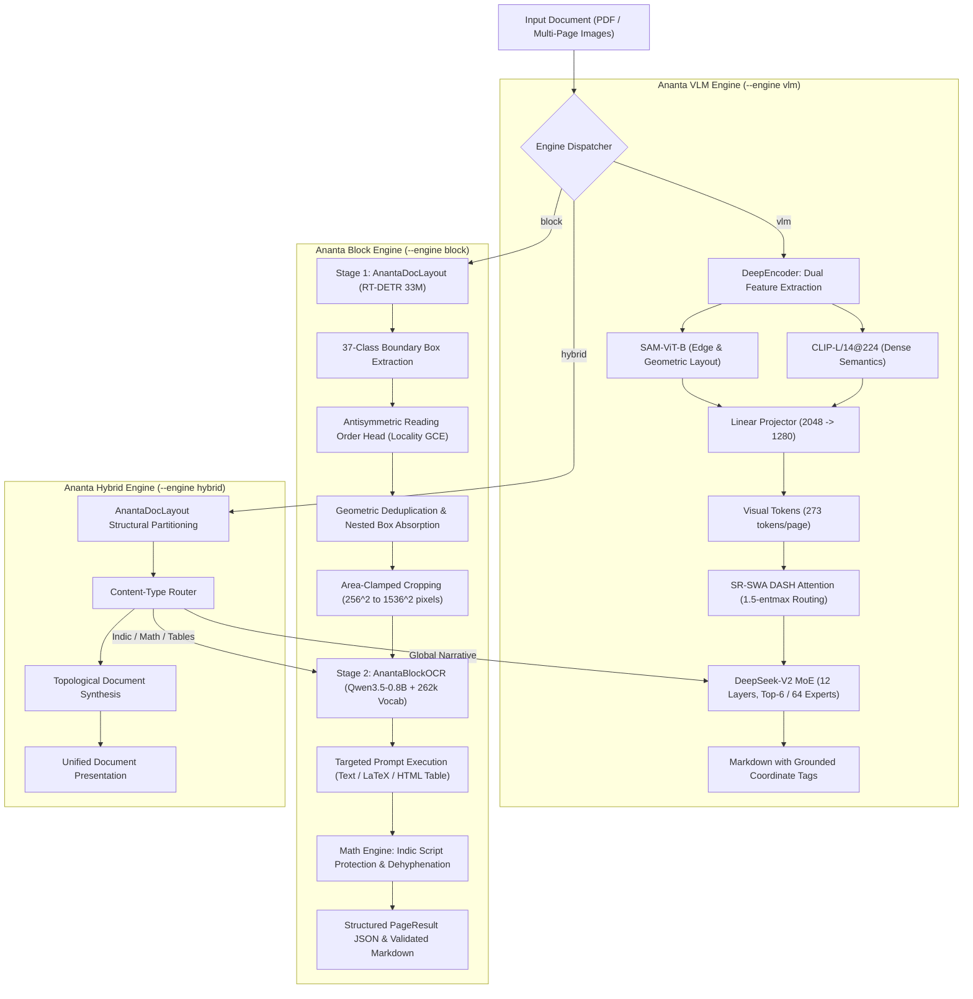
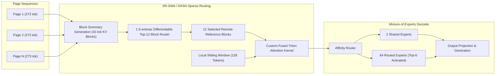
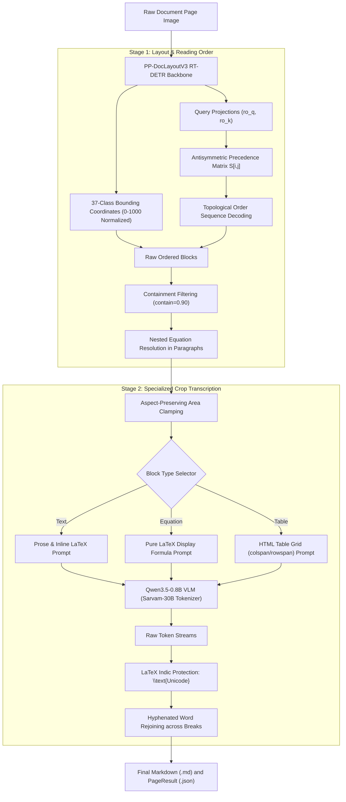
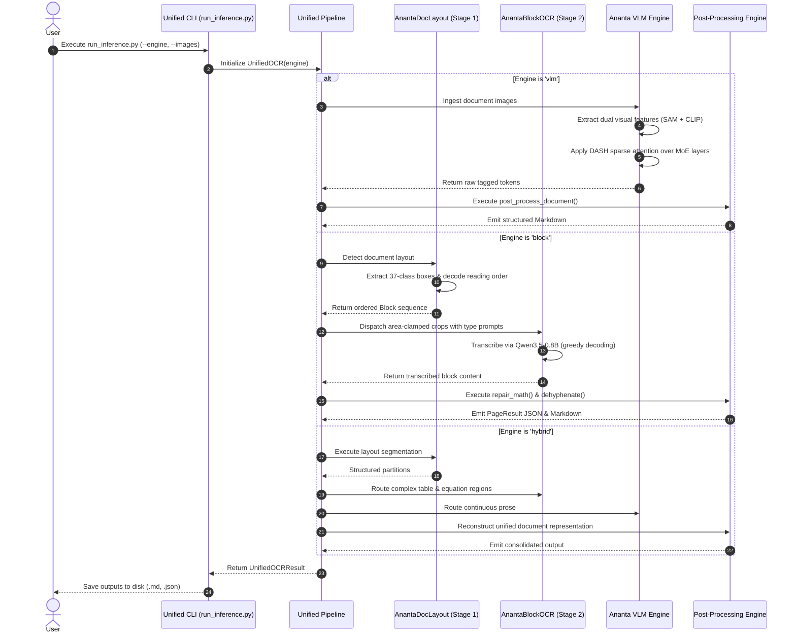

# ANANTA OCR: Advanced Visual Document Intelligence

<div align="center">

[](LICENSE)
[](https://www.apache.org/licenses/LICENSE-2.0)
[](https://www.python.org/downloads/)
[](https://pytorch.org/)
[](https://github.com/openai/triton)
[](#architecture-specifications)
[](#subsystem-1-ananta-vlm-engine)
[](#subsystem-2-ananta-block-engine)

A unified visual document parsing architecture combining unlimited-horizon multi-page document understanding across 100+ pages with fine-grained 37-class layout analysis and multilingual block recognition.

[Overview](#system-overview) • [Architecture Flows](#system-architecture-flows) • [Technical Specifications](#architecture-specifications) • [Feature Matrix](#feature-comparison-matrix) • [CLI Reference](#cli-reference) • [Python API](#python-api-reference) • [Verification Suite](#verification-suite) • [License](#license-and-attribution)

---

### [Open Interactive Architecture Visualizer](assets/architecture.html)

</div>

---

## System Overview

ANANTA OCR unifies two document understanding paradigms into a single engine:

1. **Ananta VLM Engine (`vlm`)**: A multi-page Vision-Language Model engineered for ultra-long documents (100+ pages). Utilizes dual-backbone visual compression (SAM-ViT-B + CLIP-L) to compress standard $1024 \times 1024$ pages into 273 visual tokens (16x spatial downsampling). Employs Sparse Reference Sliding Window Attention (SR-SWA / DASH) with 1.5-entmax routing to ensure strictly bounded $O(1)$ decoding memory and latency per step over a DeepSeek-V2 Mixture-of-Experts (MoE) decoder.
2. **Ananta Block Engine (`block`)**: A high-precision two-stage pipeline. Stage 1 employs AnantaDocLayout (PP-DocLayoutV3 RT-DETR, 33M parameters) to detect a 37-class document taxonomy with an antisymmetric reading-order head. Stage 2 executes AnantaBlockOCR (Qwen3.5-0.8B VLM) with a 262,144-token multilingual vocabulary covering all 22 official Indian languages and English, utilizing specialized prompts for prose, display equations, and merged HTML tables.
3. **Ananta Hybrid Engine (`hybrid`)**: Combines AnantaDocLayout topological segmentation with dynamic multi-engine routing, allocating complex visual regions to AnantaBlockOCR while preserving global document coherence through Ananta VLM.

---

## System Architecture Flows

### 1. Macro Orchestration Flow



### 2. Ananta VLM Decoding & Sparse Attention Lifecycle



### 3. Ananta Block Engine Two-Stage Detail



### 4. End-to-End Sequence Diagram



---

## Architecture Specifications

### Dual Vision Backbone (DeepEncoder)

Standard ViT backbones generate unwieldy token sequences for high-resolution images ($64 \times 64 = 4096$ tokens per image). ANANTA OCR resolves this bottleneck through a dual-encoder architecture:

- **SAM-ViT-B**: Segment Anything Model image encoder providing high-frequency boundary representation, stroke sharpness, and layout geometry.
- **CLIP-L/14@224**: Vision Transformer capturing dense semantic character representations.
- **Linear Feature Projector**: Fuses concatenated 2048-dimensional embeddings ($768 + 1024$) down to 1280 dimensions, achieving an exact allocation of **273 visual tokens per page** (16x spatial compression relative to conventional baselines).

### SR-SWA (DASH) Attention Engine

To eliminate quadratic complexity $O(N^2)$ across multi-page contexts, ANANTA OCR implements Sparse Reference Sliding Window Attention:

$$\text{Attention}(Q, K, V) = \text{Softmax}\left(\frac{Q K_{\text{active}}^T}{\sqrt{d}} + B\right) V_{\text{active}}$$

Where:
- $K_{\text{active}}$ consists of 12 global visual reference blocks dynamically selected via differentiable 1.5-entmax routing over precomputed block summaries, plus a local sliding window of 128 dynamic text tokens.
- Constant $O(1)$ decoding memory and step latency are preserved uniformly from Page 1 to Page 100+.

### DeepSeek-V2 Lineage MoE Decoder

- **Layer Count**: 12 Transformer decoder layers.
- **Hidden Dimension**: 1280.
- **Expert Architecture**: 64 routed experts + 2 shared experts.
- **Routing Mechanism**: Dynamic affinity gating activating the Top-6 routed experts per token.
- **Active Parameters**: Approximately 500M active parameters out of 3B total parameters.

### Reading-Order Head & Locality GCE

Stage 1 layout detection utilizes an antisymmetric bilinear formulation:

$$S_{ij} = \frac{(W_q q_i)^T (W_k q_j) - (W_q q_j)^T (W_k q_i)}{\sqrt{d_r}}$$

Trained via Locality-Weighted Generalized Cross-Entropy:

$$\mathcal{L}_{\text{GCE}} = \frac{1 - p_{ij}^q}{q} \cdot \exp\left(-\frac{|pos_i - pos_j|}{\tau}\right)$$

This penalizes inversion of adjacent blocks heavily while allowing robust global topological sequence recovery.

### Multilingual Tokenization & Math Repair

- **Tokenizer**: Sarvam-30B BPE tokenizer with 262,144 entries, providing native subword representations for all 22 official Indian languages and English.
- **LaTeX Math Engine**: Scans display and inline math spans for Unicode Indic runs (`\u0600-\u06ff`, `\u0900-\u0d7f`, `\u1c50-\u1c7f`) and wraps them in `\text{...}`, preventing KaTeX and MathJax compilation failures. Replaces bare newlines inside display environments with LaTeX line breaks (`\\`).

---

## Feature Comparison Matrix

| Dimension | Ananta VLM Engine (`vlm`) | Ananta Block Engine (`block`) | Ananta Hybrid Engine (`hybrid`) |
| :--- | :--- | :--- | :--- |
| **Primary Domain** | Multi-page PDFs (100+ pages), dense technical literature | Complex Indic scripts, educational exams, formulas | Mixed document portfolios with varied visual elements |
| **Model Structure** | DeepSeek-V2 MoE (~3B total / ~500M active) | RT-DETR (33M) + Qwen3.5-0.8B VLM | Dual architecture cooperative pipeline |
| **Token Cost / Page** | Strictly constant (273 tokens/page) | Crop adaptive ($256^2$ to $1536^2$ pixels) | Dynamically partitioned |
| **Attention Kernel** | SR-SWA 1.5-entmax DASH Sparse Attention | Dense SDPA / FlashAttention / vLLM | Hybrid routing |
| **Language Coverage** | Multilingual Latin & General | 22 Official Indian Languages + English | Complete cross-lingual coverage |
| **Layout Topology** | Grounded coordinate token sequence | 37-class taxonomy + pairwise reading order matrix | Topological block segmentation |
| **Table Formatting** | Markdown / HTML | HTML with colspan/rowspan & GFM Markdown | HTML with full merge preservation |
| **Formula Handling** | Inline and display LaTeX | Display LaTeX with automated Unicode protection | Multi-stage math verification |
| **Serving Options** | PyTorch / SGLang Prefix Cache | PyTorch / vLLM Continuous Batching / HTTP | End-to-end configurable |
| **Execution Hardware** | NVIDIA GPU (bfloat16 + Triton) | GPU (vLLM) or CPU (Hugging Face backend) | GPU recommended |

---

## 37-Class Layout Taxonomy Reference

The layout detection model identifies the following document components:

| Category | Classes Detected |
| :--- | :--- |
| **Headings & Structure** | `Title`, `Chapter-title`, `Section-title`, `Sub-section-title`, `Sub-sub-section-title`, `Chapter-end-section` |
| **Prose Elements** | `Paragraph`, `Footnote`, `Placeholder-text`, `Code` |
| **Educational Components**| `Question`, `Answer`, `MCQ`, `Solved-example`, `List`, `Infobox` |
| **Formulas & Mathematics**| `Equation`, `Expression` |
| **Tables & Visual Assets** | `Table`, `Table-caption`, `Image`, `Image-caption`, `Diagram`, `Chart` |
| **Publication Metadata** | `Header`, `Footer`, `Page-number`, `Folio`, `Table-of-contents`, `Index`, `Reference` |
| **Administrative & Media** | `Author`, `Dateline`, `Contact-info`, `Website-link`, `Advertisement`, `Flag` |

---

## Installation & Environment Setup

### 1. Pinned Dependencies

```bash
git clone https://github.com/Ashutosh-Yadav-256/ANANTA_OCR.git
cd ANANTA_OCR
pip install -r requirements.txt
```

### 2. Pretrained Weight Download

Download the required checkpoints from Hugging Face:

```bash
python download_weights.py --model vlm

python download_weights.py --model block

python download_weights.py --all
```

---

## CLI Reference

The unified command-line tool [`run_inference.py`](run_inference.py) provides access to all engines:

### Ananta VLM Mode (Multi-Page Ingestion)

```bash
python run_inference.py \
    --engine vlm \
    --images sample_docs/page1.jpg sample_docs/page2.jpg \
    --output-dir output/
```

### Ananta Block Mode (Two-Stage Layout & Block Recognition)

```bash
python run_inference.py \
    --engine block \
    --images exam_paper.png \
    --table-format html \
    --output-dir output/
```

### Ananta Stage 1 Only (Layout Bounding & Reading Order)

```bash
python run_inference.py \
    --engine block \
    --images document.png \
    --layout-only \
    --output-dir output/
```

### Ananta Stage 2 Only (Transcription from Precomputed Layout)

```bash
python run_inference.py \
    --engine block \
    --ocr-only output/document.layout.json \
    --output-dir output/
```

### Ananta Hybrid Mode

```bash
python run_inference.py \
    --engine hybrid \
    --images complex_page.png \
    --output-dir output/
```

### Contract & Schema Inspection

```bash
python run_inference.py show-contract
```

---

## Python API Reference

### Unified High-Level Pipeline

```python
from ananta_ocr import UnifiedOCR

vlm_pipeline = UnifiedOCR(engine="vlm", model_dir="./")
vlm_result = vlm_pipeline.process(["page1.png", "page2.png"])
print(vlm_result.markdown)
vlm_result.save("output/", base_name="vlm_document")

block_pipeline = UnifiedOCR(engine="block", table_format="html", device="cuda")
block_result = block_pipeline.process("indic_sample.png")
print(block_result.markdown)
block_result.save("output/", base_name="block_document")
```

### Direct Subsystem Access

```python
from ananta_ocr import AnantaDocLayout, AnantaBlockOCR

layout_detector = AnantaDocLayout()
page_layout = layout_detector.detect("page.png")

for block in page_layout.blocks:
    print(f"Rank {block.order}: [{block.label}] bbox={block.bbox_xyxy} conf={block.conf}")

recognizer = AnantaBlockOCR()
transcription = recognizer.run("page.png", page_layout)
print(transcription.markdown)
```

### High-Throughput Remote Serving

```python
from ananta_ocr import AnantaClient

client = AnantaClient(base_url="http://localhost:8000/v1")
result = client.parse("sample_newspaper.png")
print(result.markdown)
```

---

## Verification Suite

ANANTA OCR includes an automated unit test suite verifying geometric filtering, taxonomy parsing, prompt generation, math sanitization, and pipeline initialization:

```bash
python -m unittest discover -s tests -v
```

All 15 automated test cases validate deterministic behavior across all supported subsystems.

---

## Repository Structure

```text
ANANTA_OCR/
|-- assets/
|   `-- architecture.html
|-- wheel/
|   `-- sglang-*.whl
|-- utils/
|   `-- process_anantaocr.py
|-- ananta_engine/
|   |-- engine/
|   |   |-- types.py
|   |   |-- blocks.py
|   |   |-- crops.py
|   |   |-- reconstruct.py
|   |   |-- layout.py
|   |   |-- recognizer.py
|   |   |-- recognizer_vllm.py
|   |   |-- checkpoints.py
|   |   `-- offline.py
|   |-- layout/
|   |   |-- labels.py
|   |   |-- order_loss.py
|   |   |-- modeling_ppdoc.py
|   |   `-- infer.py
|   |-- templates/
|   |   `-- contract.py
|   |-- serving/
|   |   |-- client.py
|   |   `-- recognizer_http.py
|   `-- inference/
|       |-- common.py
|       `-- cli.py
|-- tests/
|   `-- test_ananta_ocr.py
|-- unified_pipeline.py
|-- run_inference.py
|-- download_weights.py
|-- dash_attention.py
|-- deepencoder.py
|-- modeling_anantaocr.py
|-- modeling_deepseekv2.py
|-- sparse_gather_e2e_triton.py
|-- sparse_gather_triton.py
|-- config.json
|-- tokenizer.json
|-- requirements.txt
\-- README.md
```

---

## License and Attribution

ANANTA OCR is distributed under open-source licenses:

- **ANANTA OCR Core Engine & Triton Kernels**: Released under the **MIT License**. Copyright (c) 2026 AnantaOCR Contributors. Portions Copyright (c) 2026 Baidu.
- **ANANTA OCR Block & Layout Components**: Derived from foundational open-source research from Bodhan AI, licensed under the **Apache License 2.0**. Copyright (c) 2026 Contributors.

```text
MIT License

Copyright (c) 2026 AnantaOCR Contributors
Portions Copyright (c) 2026 Baidu

Permission is hereby granted, free of charge, to any person obtaining a copy
of this software and associated documentation files (the "Software"), to deal
in the Software without restriction, including without limitation the rights
to use, copy, modify, merge, publish, distribute, sublicense, and/or sell
copies of the Software, and to permit persons to whom the Software is
furnished to do so, subject to the following conditions:

The above copyright notice and this permission notice shall be included in all
copies or substantial portions of the Software.
```

```text
Apache License, Version 2.0

Licensed under the Apache License, Version 2.0 (the "License");
you may not use this file except in compliance with the License.
You may obtain a copy of the License at

    http://www.apache.org/licenses/LICENSE-2.0

Unless required by applicable law or agreed to in writing, software
distributed under the License is distributed on an "AS IS" BASIS,
WITHOUT WARRANTIES OR CONDITIONS OF ANY KIND, either express or implied.
See the License for the specific language governing permissions and
limitations under the License.
```
